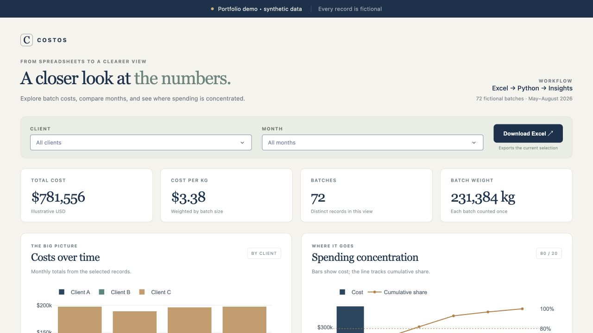
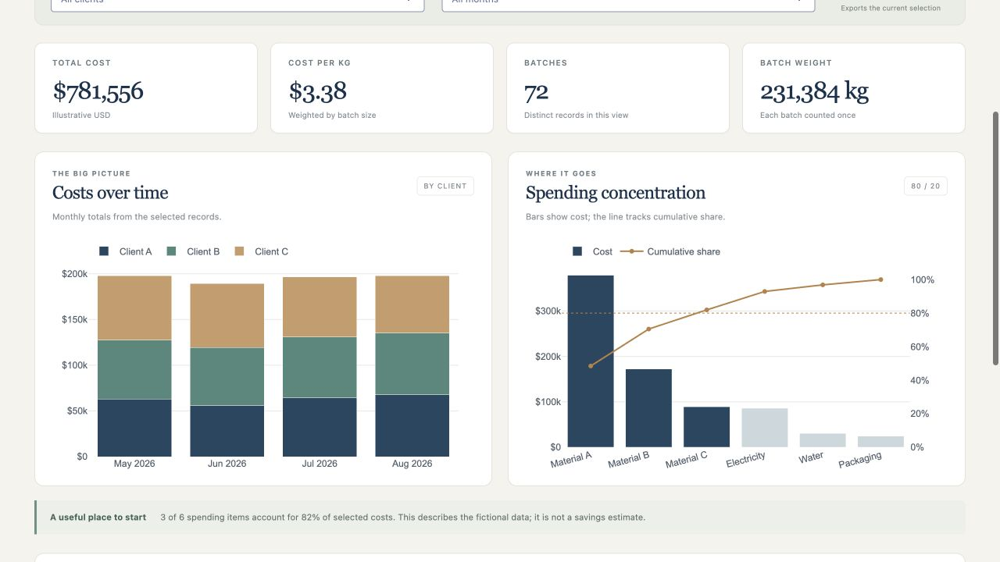

# Costos: a closer look at monthly costs

I worked on Costos during my Curfimex internship, using Python to organize Excel records and Dash and Plotly to make the numbers easier to explore. This public demo gives you a small example of that work.

The questions behind it are straightforward: How do costs change from month to month? Which materials account for most spending? How do costs compare across customers and batches?

**Everything shown here is synthetic:** the customers, batches, prices, quantities, and patterns are made up. This repository contains a separate demo, with no company records or connection to company systems.

I'm [Eduardo](https://github.com/edu-sal), a Statistics senior at American University. I used Codex for coding and debugging assistance on the internship app and this demo.

## Take a look

The overview brings together the selected months, clients, and cost summaries. All amounts below are fictional.



Monthly comparisons and the Pareto chart show how costs are distributed in the generated sample.



## What you can explore

- Filter fictional records by client and month.
- Compare monthly costs and cost per kilogram.
- Use a Pareto chart to see which spending items account for most of the total.
- Review the batch-level records behind the charts.
- Download an Excel workbook containing the current selection and its summaries.

The demo starts with an actual Excel file generated from a fixed random seed: 72 fictional batches across May–August 2026. Python reads that file with openpyxl, cleans and checks its columns, and uses pandas for the summaries. Dash and Plotly provide the interface and charts.

## Run locally

Use Python 3.11 or newer. From the project directory:

```bash
python -m venv .venv
source .venv/bin/activate
python -m pip install -r requirements.txt
python app.py
```

Open [http://127.0.0.1:8050](http://127.0.0.1:8050). Set `PORT` if that port is already in use.

The app regenerates `demo/synthetic_records.xlsx` when it starts. That directory is ignored by Git. The input is created entirely in code; there is no connection to a private database or fallback to local company files. No external services or credentials are needed.

## How the numbers work

Each spreadsheet row represents one spending item in a batch. Costs are summed across those rows. Batch weight is counted once per batch, so cost per kilogram is total selected cost divided by total selected batch weight. Monthly comparisons use the same calculation.

The Pareto chart orders spending items by cost. Its highlighted set includes the item that first takes cumulative spending to at least 80%. It describes cost concentration; it does not measure savings. All currency values are illustrative USD.

The exported workbook includes Summary, Monthly, Batches, Material costs, and Detail sheets. It contains numeric snapshots of the selected data rather than live formulas.

## Check the calculations

```bash
python -m unittest discover -s tests -v
```

The checks cover weighted aggregation, filters, the Pareto threshold, Excel input validation, and reconciliation of exported records with the current selection.

## Files

- `demo_data.py` — deterministic fictional Excel records.
- `analysis.py` — parsing, validation, summaries and Excel export.
- `app.py` — the dashboard and filter/download callbacks.
- `assets/style.css` — dashboard styling.
- `tests/test_analysis.py` — calculation and export checks.

Built with Python, pandas, openpyxl, Dash and Plotly. Codex assisted with this public demo's implementation and debugging.
